# Ateliê Camadas

Painel de estudo, em português, para observar camadas de layout, botões, cores de status e sobreposições. A página é estática: HTML, CSS e JavaScript sem framework, sem CDN e sem servidor de aplicação.

## Objetivos

- Mostrar, na mesma tela, a ordem de pintura da página e a diferença entre `z-index` e a top layer do navegador.
- Exercitar três sobreposições com papéis diferentes: diálogo modal, gaveta lateral modal e notificação não modal. Um glossário ancorado completa o contraste, sem ser um segundo modal.
- Tratar cor de status sempre com texto e ícone.
- Manter o fluxo utilizável no teclado, em 320px de largura e com `prefers-reduced-motion`.
- Deixar explícito que nada é enviado, gravado ou publicado.

## Autoria, escopo e a referência do Figma

Esta interface é uma criação original para o laboratório de Layers & Overlays. O arquivo indicado em `https://www.figma.com/file/SyTdgG69kIeXW54Sg5Ui5W/Layers-%26-Overlays?node-id=1%3A3` não foi inspecionado: o conector do Figma recusou o acesso por falta de permissão de edição. Não houve outra tentativa de abrir esse arquivo, nenhuma tela foi copiada dele e este repositório não afirma fidelidade a essa referência. Nenhum arquivo do Figma foi criado por este trabalho.

O tema é um pequeno painel para ligar leituras de estudo ao caderno de um portfólio. As quatro notas iniciais são conteúdo didático fixo. Uma sessão anotada ou uma nota de exemplo existe só na memória da aba e some ao recarregar.

## Como abrir e executar

Não há instalação obrigatória para ver o painel.

1. Abra `index.html` no navegador, direto do disco.
2. Ou, na pasta do projeto: `python3 -m http.server 4173` e acesse `http://127.0.0.1:4173`.

Os testes automatizados usam o Chrome já instalado na máquina e dependências locais de desenvolvimento:

```bash
npm install
npm test
```

`npm test` executa `node tests/overlays.test.mjs`. O Playwright sobe o Chrome do sistema (`channel: "chrome"`) e abre a página por `file://`. Não publique esta pasta em GitHub Pages nem em outro hosting: o laboratório pede só a demonstração local.

## Estrutura

| Caminho | Função |
| --- | --- |
| `index.html` | Painel, diálogo, gaveta, glossário e área de notificações |
| `css/styles.css` | Layout, estados dos botões, cores de status e animação |
| `js/app.js` | Abertura, foco, validação local, notas em memória e toasts |
| `tests/overlays.test.mjs` | Testes de interação, geometria e axe-core |
| `tests/last-run.json` | Resultado da última execução guardada neste repositório |
| `images/` | Capturas geradas por essa execução |

## Conceitos de camada

De baixo para cima, nesta página:

```text
┌──────────────────────────────────────────────────────────┐
│ Top layer do documento                                   │
│   diálogo modal ou gaveta (um por vez) + ::backdrop      │
│   glossário, quando aberto, também na top layer          │
│   ordem: o último promovido fica por cima (LIFO)         │
├──────────────────────────────────────────────────────────┤
│ z-index 9999  faixa de prova, se o botão a mostrar       │
│               continua no documento, fora da top layer   │
├──────────────────────────────────────────────────────────┤
│ z-index 30    notificações (position: fixed)             │
├──────────────────────────────────────────────────────────┤
│ z-index 20    cabeçalho sticky                           │
│               o contexto prende os filhos deste bloco    │
├──────────────────────────────────────────────────────────┤
│ z-index auto  conteúdo em fluxo normal                   │
├──────────────────────────────────────────────────────────┤
│ fundo do body                                            │
└──────────────────────────────────────────────────────────┘
```

Os números 20, 30 e 9999 estão no CSS e repetidos na lista “Ordem das camadas desta página”. O teste compara o texto com o `z-index` calculado.

### Contexto de empilhamento

Um contexto de empilhamento é um grupo pintado junto. O `z-index` só compara elementos que participam do mesmo contexto. Criam contexto, entre outros casos: elemento posicionado com `z-index` diferente de `auto`; `position: fixed` ou `sticky`; `opacity` menor que 1; `transform`, `filter`, `perspective`, `clip-path` ou `mask`; `isolation: isolate`; item de flex ou grid com `z-index` diferente de `auto`.

No palco “Contexto de empilhamento”, o pai tem `position: absolute` e `z-index: 0`, então forma um contexto. O filho, com `z-index: 50`, fica dentro dele. O irmão do pai tem `z-index: 1` e é pintado depois do contexto inteiro do pai. Por isso o irmão cobre o filho, mesmo com um número menor. O teste aponta o centro da interseção e confirma que `.stack-sibling` aparece antes de `.stack-child` em `elementsFromPoint`.

### Top layer, pano de fundo e z-index

`dialog.showModal()` promove o diálogo à top layer, desenha o `::backdrop` imediatamente atrás dele e torna o restante do documento inerte. O `::backdrop` tem o tamanho da viewport, não herda do diálogo e só existe nessa apresentação. `z-index` de um elemento comum não o coloca acima dessa camada.

Nesta página o diálogo não recebe `z-index`. No Chrome 156.0.8078.47 o valor calculado ficou `auto` e, ainda assim, o diálogo cobre a faixa `z-index: 9999`. No ponto medido sobre a faixa, `elementsFromPoint` devolveu primeiro `#session-dialog` e depois `HTML`. O `::backdrop` não é um nó do DOM, então não entra nessa lista. A captura `images/desktop-prova-zindex.png` mostra a faixa escurecida pelo pano de fundo e interrompida pelo diálogo.

Vários itens na top layer seguem a ordem de promoção: o último a entrar fica por cima. Este painel evita dois diálogos modais ao mesmo tempo. Abrir um fecha o outro na hora, e os botões de fora ficam inativos enquanto um modal está aberto. O glossário também entra na top layer, mas não deixa a página inerte; ao abrir o diálogo, o glossário é fechado antes.

`dialog.show()` não é usado. Esse método não promove à top layer, não cria `::backdrop` e não torna o documento inerte.

## Interações

Tudo fica no navegador. Não há `fetch`, conta, envio de formulário nem `localStorage`.

| Controle | O que acontece |
| --- | --- |
| Nova sessão de estudo | Abre o diálogo modal. O foco vai para o tema. |
| Anotar nesta aba | Valida tema, anotação e a confirmação. Se faltar algo, o diálogo continua aberto e lista o erro com ícone e a palavra “Erro”. Se estiver válido, fecha e mostra a notificação de sucesso. A nota entra no caderno só na memória. |
| Cancelar, Fechar, Esc ou clique no pano de fundo | Fecha sem anotar. O foco volta ao botão que abriu. |
| Abrir caderno | Abre a gaveta pela direita. É o mesmo `<dialog>` modal, com outra geometria. |
| Ler nota no caderno | Abre a mesma gaveta e move o foco para a nota pedida. |
| Adicionar nota de exemplo | Inclui um texto fixo de demonstração e foca essa nota. |
| Glossário | Abre um popover ancorado ao botão. Esc, o botão Fechar ou um clique fora fecham. A página continua utilizável. |
| Mostrar informação / Mostrar atenção | Empilham uma notificação com rótulo, ícone e Fechar. O foco não se move. Nada some sozinho. |
| Mostrar faixa z-index 9999 | Liga ou desliga a faixa de prova. |
| Publicar no portfólio (desativado) | Permanece desativado. O texto ao lado explica a ausência de conta e de envio. |

Há no máximo quatro notificações. A quinta remove a mais antiga na hora, para a pilha não cobrir a tela. Isso não é um prazo de leitura.

## Acessibilidade

- A página está em `lang="pt-BR"`, com um link “Ir para o conteúdo” e um `main`.
- Diálogo e gaveta usam `showModal()`, com nome acessível no título. O glossário é uma região nomeada, não um diálogo, porque não é modal.
- Esc fecha diálogo, gaveta e glossário.
- Ao abrir, o foco entra no controle inicial ou na nota pedida. Ao fechar, o navegador devolve o foco ao controle que abriu.
- Tab e Shift+Tab circulam dentro do modal. No Chrome desta execução, um Tab no último controle chegava a cair no `body` por um instante, antes do sentinela do navegador corrigir. O script impede esse salto e leva o foco direto à outra extremidade.
- Com o modal aberto, `focus()` num botão de fora não tira o foco do diálogo, e o clique real do Playwright nesse botão não dispara a ação. O seletor CSS `:inert` não existe neste Chrome (`matches(':inert')` lança erro), então a inércia foi observada pelo foco e pelo ponteiro, não por esse seletor.
- Um `HTMLElement.click()` programático, chamado de dentro da página, ainda disparou o listener de um botão coberto pelo modal neste Chrome. O handler fecha o modal atual antes de abrir o outro, então os dois não permanecem empilhados. O caminho de teclado e de ponteiro não alcança esse botão.
- O fundo não rola enquanto o modal ou a gaveta estão abertos: o `body` fica `position: fixed` na posição já rolada e a posição é restaurada ao fechar.
- A região rolável do diálogo e a da gaveta têm `tabindex="0"` e nome acessível.
- Notificações usam `role="status"`. Aparecer não move o foco. O botão diz “Fechar” e o nome acessível inclui o tipo (“Fechar notificação de sucesso”, por exemplo). Não há temporizador de fechamento. O teste espera 2,5s e a notificação continua.
- Botões visíveis têm altura e largura de pelo menos 44px, com hover, `:focus-visible` e estado desativado distintos. O desativado usa borda tracejada, cursor `not-allowed` e o rótulo “(desativado)”, além do parágrafo de ajuda.
- Informação, sucesso, atenção e erro têm ícone e palavra, não só cor.
- `prefers-reduced-motion: reduce` zera transição e animação. Esc fecha na hora.

## Animação

A entrada do diálogo, da gaveta e do glossário usa `@starting-style` com transição de opacidade e deslocamento, incluindo `overlay` e `display` com `allow-discrete`. A saída do diálogo e da gaveta adiciona a classe `is-closing`, espera o fim da transição (ou 360ms) e só então chama `close()`. Com movimento reduzido, `close()` é imediato e o CSS usa `transition: none`.

A notificação entra e sai com animação própria. Com movimento reduzido ela aparece e some sem animação.

## Testes realizados e limitações

Última execução guardada em `tests/last-run.json`:

- Data: 2026-11-06T21:03:07.581Z
- Chrome: 156.0.8078.47, headless, via Playwright
- axe-core: 4.14.0
- Resultado: 14 testes passaram, 0 falharam
- Pedidos de rede fora de `file:` e `data:`: nenhum
- `localStorage`, `sessionStorage` e cookie continuaram vazios depois de anotar uma sessão e criar uma nota de exemplo

O que a suíte cobre:

- Abrir e fechar o diálogo pelo botão Fechar, por Cancelar, por Esc e pelo pano de fundo, com o foco de volta em “Nova sessão de estudo”.
- Validação que mantém o diálogo aberto e o envio válido, que gera nota e notificação sem mover o foco para ela.
- A notificação permanece depois de 2,5s e só sai pelo Fechar.
- Gaveta aberta pelo cartão, por Esc, pelo pano de fundo e pelo botão, com foco na nota ou no Fechar e retorno ao controle de origem.
- Glossário sem comportamento modal, Esc, clique fora e fechamento ao abrir o diálogo.
- Rolagem da página travada no modal e restaurada no mesmo ponto, inclusive depois da roda do mouse sobre o pano de fundo.
- Diálogo em 390×480 com rolagem interna e caixa dentro da viewport.
- Faixa `z-index: 9999` atrás do diálogo modal; irmão do palco acima do filho.
- Movimento reduzido com duração de transição de no máximo 0,05s.
- 320px sem rolagem horizontal no repouso, no modal, na gaveta, na notificação e no glossário. Botões visíveis com alvo de 44px.
- axe-core sem violações em: repouso 1280, modal 1280, gaveta 1280, toast 1280, glossário 1280, repouso 320 e modal 320×480.

Limitações, sem completar o que não foi feito:

- Só este Chrome foi exercitado. Não houve Firefox, Safari, leitor de tela nem aparelho físico.
- O axe-core não esgota a WCAG. Contraste, nome e alguns padrões sim; significado do texto, ordem de leitura com leitor de tela e o incômodo do foco não.
- A emulação de viewport e de `prefers-reduced-motion` não substitui o sistema operacional nem um telefone.
- O clique programático `element.click()` não foi bloqueado pela inércia neste Chrome, como descrito acima.
- O glossário pode rolar por dentro quando o espaço abaixo do botão é curto.
- Não há implantação nem GitHub Pages.

## Capturas

Geradas pela suíte, a partir da página local.

### Painel

Desktop, 1280×800, topo da página:

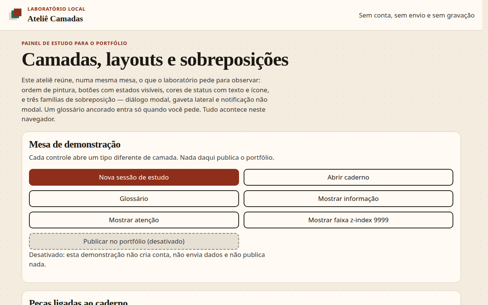

Página inteira no desktop, com cartões, cores, palco de empilhamento e a lista de camadas:

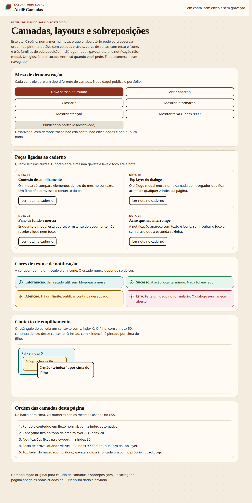

Largura de 320px, página inteira:

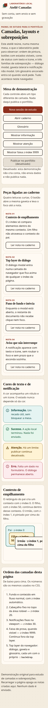

### Diálogo modal

Desktop:

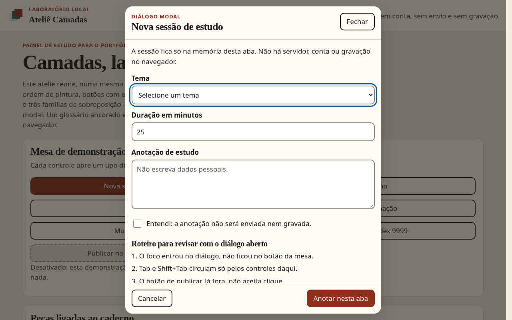

320px:

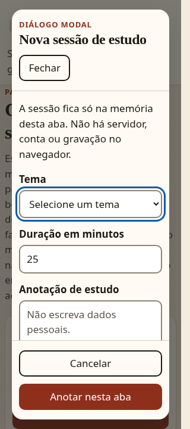

Viewport baixa (1280×520), com o roteiro rolado dentro do diálogo e os botões de ação ainda visíveis:

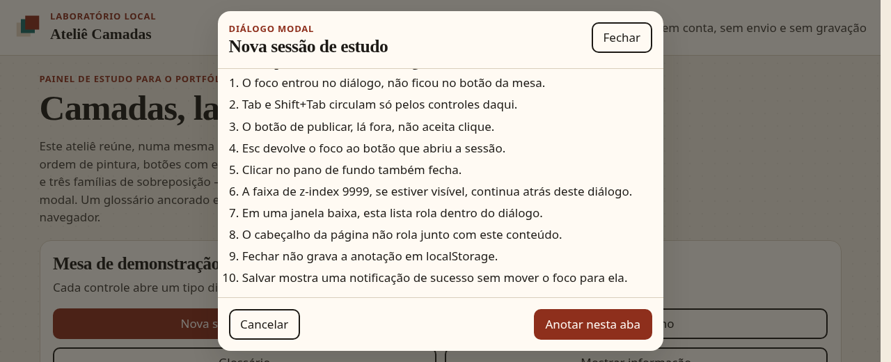

Faixa de `z-index: 9999` coberta pelo diálogo e pelo pano de fundo:

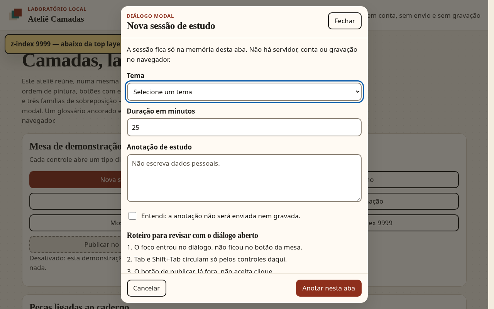

### Gaveta

Desktop:

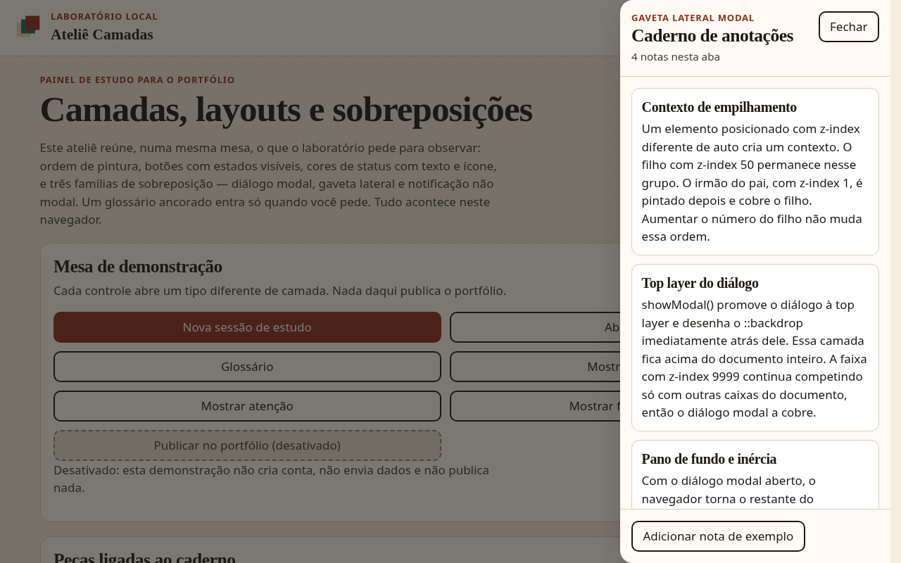

320px, com uma faixa do pano de fundo à esquerda:

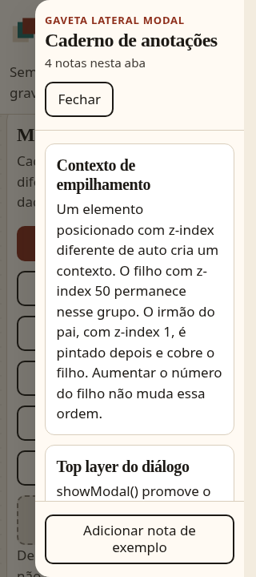

### Notificações

Desktop, informação e atenção, sem tomar o foco dos botões da mesa:

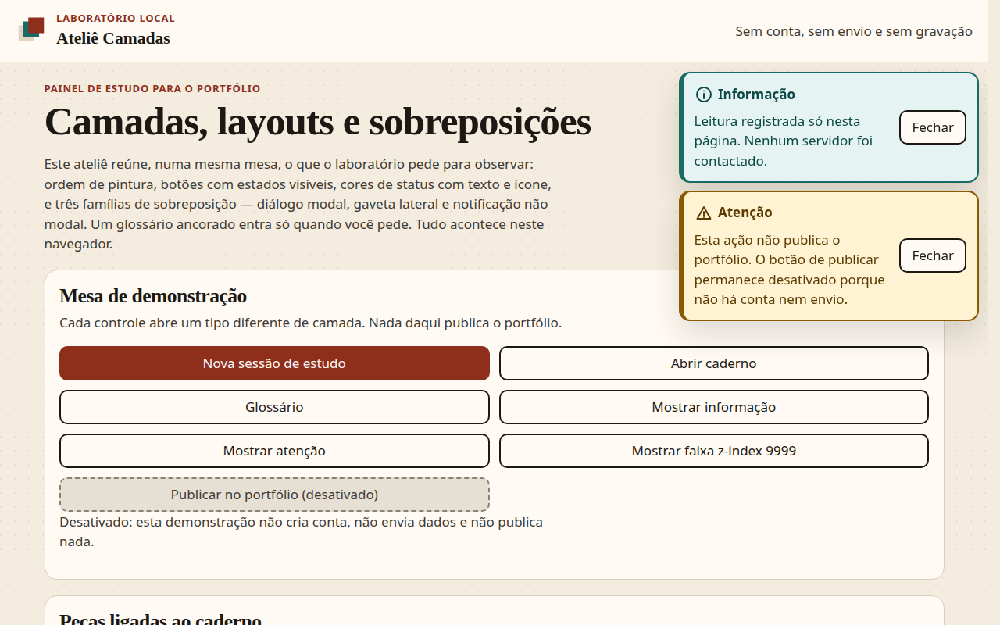

320px:

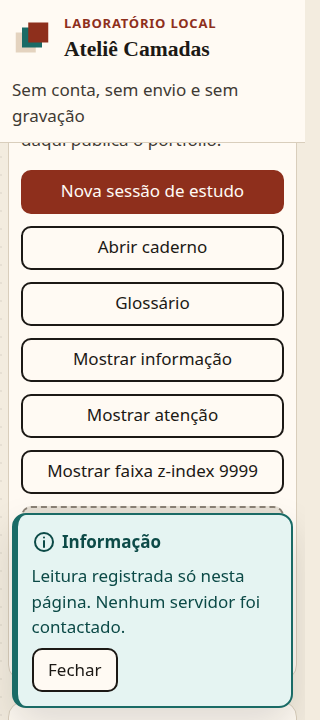

### Glossário

Popover ancorado, com a página ainda visível ao redor:

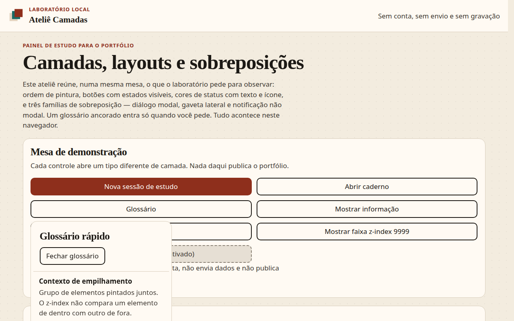

## Texto curto para a submissão na DIO

Implementei uma demonstração original, em HTML, CSS e JavaScript puro, de um painel de estudos sobre camadas e sobreposições. A referência do Figma não pôde ser inspecionada pelo conector, por falta de permissão de edição; a interface não reproduz esse arquivo e não alega fidelidade a ele. O painel mostra diálogo modal, gaveta lateral e notificação não modal, além de um glossário ancorado, com foco preso no modal, retorno ao controle que abriu, fundo inerte, Esc, pano de fundo e animação que respeita a redução de movimento. Tudo funciona localmente, sem conta, sem envio e sem gravação.
